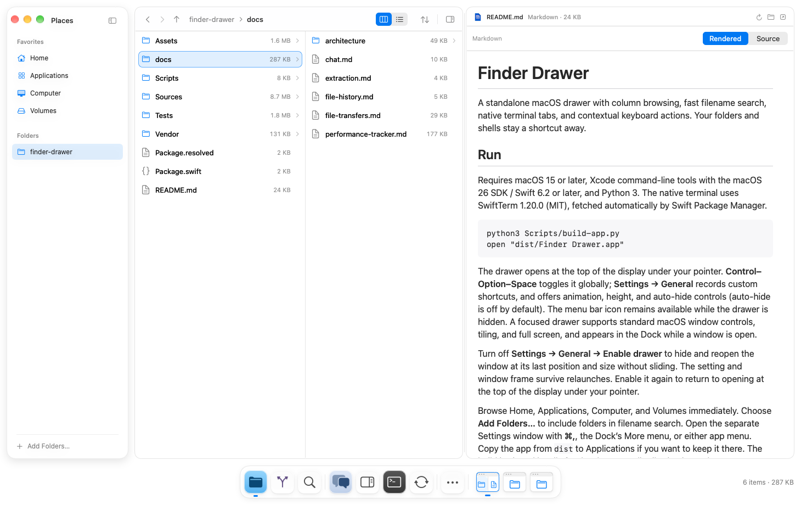
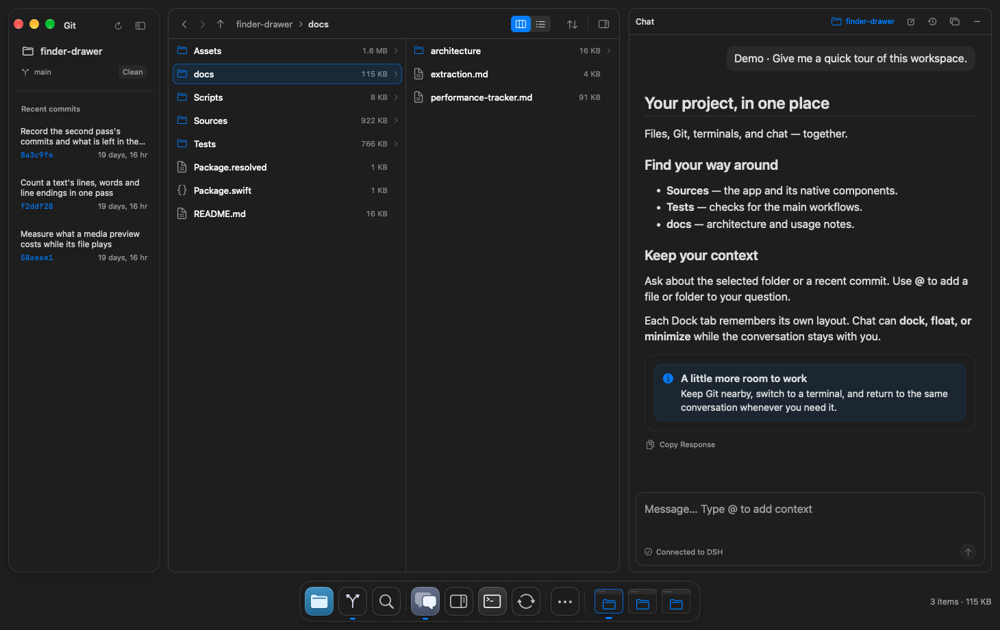

# Finder Drawer

A standalone macOS drawer with column browsing, fast filename search, native terminal tabs, and contextual keyboard actions. Your folders and shells stay a shortcut away.





*Git history and docked Chat, shown with a demo conversation.*

## Run

Requires macOS 15 or later, Xcode command-line tools with the macOS 26 SDK / Swift 6.2 or later, and Python 3. The native terminal uses SwiftTerm 1.20.0 (MIT), fetched automatically by Swift Package Manager.

```sh
python3 Scripts/build-app.py
open "dist/Finder Drawer.app"
```

The drawer opens at the top of the display under your pointer. **Control–Option–Space** toggles it globally; **Settings → General** records custom shortcuts, and offers animation, height, and auto-hide controls (auto-hide is off by default). The menu bar icon remains available while the drawer is hidden. A focused drawer supports standard macOS window controls, tiling, and full screen, and appears in the Dock while a window is open.

Turn off **Settings → General → Enable drawer** to hide and reopen the window at its last position and size without sliding. The setting and window frame survive relaunches. Enable it again to return to opening at the top of the display under your pointer.

Browse Home, Applications, Computer, and Volumes immediately. Choose **Add Folders…** to include folders in filename search. Open the separate Settings window with **⌘,**, the toolbar gear, or either app menu. Copy the app from `dist` to Applications if you want to keep it there. The build is signed locally for development; distributing it to other Macs requires your own signing and notarization.

## What it does

- Native column browsing with keyboard navigation, independent tabs, folder shortcuts, and live directory updates.
- Rename, new folder, trash, multi-selection, drag-and-drop, Open With, copy paths, and reveal in Finder.
- Indexed file and folder **name** search, including filename substrings and short queries. Return on a search result reveals it in the browser; Open launches its default application.
- Search-result previews and Space for Quick Look; sorting, hidden-file visibility, and file-size preferences.

Search includes only the folders you choose, omits hidden files/package descendants, and respects nested `.gitignore` rules plus cache exclusions. It returns up to 200 matches. File contents are not indexed. The index refreshes at launch, when showing the drawer, after its file operations, or with **Refresh Search Index**. Open columns watch for external changes; the search index does not continuously watch every folder recursively.

## Keyboard

| Action | Shortcut |
| --- | --- |
| Show / hide drawer globally | ⌃⌥Space |
| Context actions for the selection | ⌘K |
| Search files | ⌘F or ⌘/ |
| New terminal in selected folder | ⌘T |
| Toggle sidebar | ⌃⌘S |
| Next / previous tab | ⌃Tab / ⌃⇧Tab |
| Select tab or pair 1–9 | ⌘1–⌘9 |
| Go to folder / recent locations | o or ⇧⌘G |
| Split right / unpair tabs | ⌘\ / ⇧⌘\ |
| Focus the other pane | ⌥⌘← / ⌥⌘→ |
| New file tab / close tab | ⌘N / ⌘W |
| Move between columns | ← / → or Tab / ⇧Tab |
| Parent folder | ⌘↑ |
| Open selection | ⌘Return or ⌘↓ |
| Rename selection | Return |
| Quick Look | Space or ⌘Y |
| New folder | ⇧⌘N |
| Move selection to Trash | ⌘Delete |
| Copy / cut selected files | ⌘C / ⌘X |
| Paste files | ⌘V |
| Move copied files here | ⌥⌘V |
| Duplicate selection | ⇧⌘D |
| Split with terminal / file browser | ⌘D / ⌘S |
| Undo / redo file operation | ⌘Z / ⇧⌘Z |
| Select all files in the focused column | ⌘A |
| Copy selected paths | ⌥⌘C |
| Toggle hidden files | ⌘. |
| Settings | ⌘, |
| Leave search / hide drawer | Escape |

The wider centered palette has actions (⌘K), file search (⌘F or the search icon), and location navigation (o or ⇧⌘G). Type to filter, use ↑/↓ to select, Return to open, and Escape to dismiss. Location navigation fuzzy-matches recent folders, accepts absolute, relative, and ~ paths, and uses Tab to complete a folder. Search stays above the browser in a fixed-height palette, with 40% of its width for filename results and 60% for an embedded Quick Look preview. Click or use ↑/↓ (also Control-N/P) to select, Page Up/Down to move through results, and Return or double-click to reveal a result in the browser. The selection scrolls into view as you move. Previews do not autoplay media; file contents are not indexed. Commands adapt to the selected file, folder, search result, or terminal. “Open Terminal Here in New Tab” uses a selected folder, a file’s parent, or the current folder. The header shares one native toolbar row with the traffic lights, with its location title aligned to the main content. The sidebar toggle animates and remembers its state. Settings, Actions, and Search live below a separator at the bottom of the sidebar; the old window status bar is removed. The tab-add and split buttons share a compact group immediately after the last tab and brighten on hover. The sidebar background continues behind the native window controls.

Use the Split View menu to pair two file browsers, a browser and terminal, or two terminals side by side. A pair appears as one joined item in the tab strip and keeps both locations together when switching tabs. Click either half or use ⌥⌘←/→ to focus its pane. New file and terminal tabs open as singles; ⌃Tab and ⌘1–9 switch between tab-strip items, including whole pairs. Right-click a pair and choose **Unpair Tabs** (or use ⇧⌘\) to restore adjacent singles without closing either session. The pair’s close button and ⌘W close both members. Drag a single tab over the center of an adjacent single to preview a group with a soft outline. Move away to dismiss the preview, or release to animate them into a pair. Both sessions stay alive, retain their left-to-right order, and the dragged tab keeps focus. Reduce Motion removes the animation. To reorder, drop at a tab’s edge or between tabs; existing pairs move together when dragged by either half. Drop on the add/split controls to move to the end. Tab order is saved across relaunches. Drag the pane divider to resize. Multiple pairs and their focused panes restore after relaunch; older saved splits migrate to a pair. Settings → General provides independent width and height percentages for the next global-shortcut opening.

Terminal tabs run your login shell in a native PTY, supporting interactive programs, copy/paste, and resizing. Default terminal and selection colors follow the window’s macOS light, dark, and high-contrast appearance, including existing tabs, without restarting shells. **Settings → Appearance** offers separate light- and dark-mode theme dropdowns: Catppuccin Mocha, Dracula, Nord, Solarized Dark, Catppuccin Latte, Solarized Light, and Nord Snow (a light adaptation). Choices are saved and apply immediately to existing and future terminals, including background tabs, without losing shell state or scrollback. Themes include all 16 ANSI colors, text, background, selection, and a contrasting cursor. Choose System to restore native colors; programs that explicitly set their own colors retain control of their output. Switching tabs or hiding the drawer keeps sessions running. Closing a terminal tab ends its shell and foreground job; quitting ends all sessions. Tabs and directories restore after relaunch, with fresh shells started only when viewed. Commands and scrollback are not restored. Shells that report their current directory with OSC 7 update the tab context; other shells retain their starting directory. Browser write restrictions do not sandbox terminal commands.

File copy/paste uses the macOS clipboard and interoperates with Finder. Cut leaves originals in place until pasted in Finder Drawer; other apps see ordinary copied files. Paste targets the selected folder, or the focused column's folder when no single folder is selected. Name collisions keep both items with a numbered name; duplicate and same-folder copy use “copy” names. Transfers run in the background and report partial failures. Right-click empty column space to paste directly into that column.

File tabs keep undo/redo history for copying, moving, duplicating, renaming, new folders, and Trash until the tab closes. Undoing a copy sends its created items to Trash; redo restores them. Restore never overwrites an existing item, and history refuses to act on files replaced since the original operation.

Text fields keep normal editing shortcuts. Quick Look and folder/settings dialogs handle their own keys.

## Develop or reuse

Open `Package.swift` in Xcode, or run:

```sh
swift test
```

If the macOS 27 beta Swift build engine stalls, use `swift test --build-system native` and `python3 Scripts/build-app.py --build-system native`.

`FinderDrawerKit` contains the browser, SQLite index, and standalone window host. `FinderDrawer` is the small executable that adds the app/menu-bar lifecycle and global shortcut. Another macOS app can add this package as a local dependency and retain a `FinderDrawerController`:

```swift
import FinderDrawerKit

// Create on the main actor and retain for the lifetime of the host app.
let drawer = try FinderDrawerController()
drawer.show()
// Call drawer.shutdown() when the host terminates.
```

The controller accepts a custom index URL, UserDefaults instance, and initial folders. Embedders should supply their own index URL and preferences domain. Browser implementation types are internal; the controller is the initial public integration point.

Finder Drawer keeps its index in `~/Library/Application Support/FinderDrawer/index.sqlite3` and preferences under `com.stevemurr.finder-drawer`. The standalone app permits file operations throughout locations your account can access by default. Settings → Files & Access can restrict writes to indexed folders; those boundaries resolve symlinks. Search indexing remains limited to explicitly chosen folders in either mode. Package embedders retain restricted writes by default and can opt in with `allowsSystemWideAccess: true`.

This app is not App Sandbox enabled. macOS still enforces filesystem permissions, protected system volumes, and privacy controls. Full Disk Access cannot be granted by an entitlement or enabled automatically. Use **Settings → Files & Access → Open Full Disk Access…**, add the built app, enable it, then quit and reopen it. The adjacent **Show App in Finder** action locates the exact app bundle. Local ad-hoc rebuilds can require granting access again; use a stable Developer ID signing identity for distribution. A sandboxed host would need a security-scoped bookmark adapter.

Native Liquid Glass is used for search and toolbar controls on macOS 26 and later, including macOS 27. Older systems use vibrancy; Reduce Transparency provides solid control surfaces, and Reduce Motion disables the drawer animation. No Accessibility permission is needed to manage this app’s own window or register its global shortcut.

See [the extraction record](docs/extraction.md) for provenance, boundaries, tests, and intentional differences from the old interface.

### File preview canvas

Selecting one file opens a rounded preview beside the browser; folders, empty selections, and multi-selections keep the full browser area. File rows show larger native icons or media thumbnails with secondary kind/size details. Column/list controls, breadcrumb navigation, sorting, and folder Back/Forward are available above the browser.

- Audio: sampled stereo waveform, scrubbing, playback speed, and sample-rate/channel/bit-depth metadata when supplied by the file.
- Video: native playback and scrubbing, codec/resolution/frame-rate and available color metadata.
- Images: bounded image preview with zoom and available image/camera metadata.
- PDF: native selectable pages, paging, and zoom.
- Code/text: selectable read-only text, lightweight syntax highlighting and line numbers for recognized source files.
- Markdown: common block and inline formatting, plus a source toggle. Other formats use Quick Look.

Space plays or pauses selected audio/video after its preview loads. Escape clears a file preview before hiding the drawer. Text previews are limited to the first 256 KB; image previews are downsampled to at most 2,000 pixels. Playback stops when the preview is dismissed or its tab is changed.
